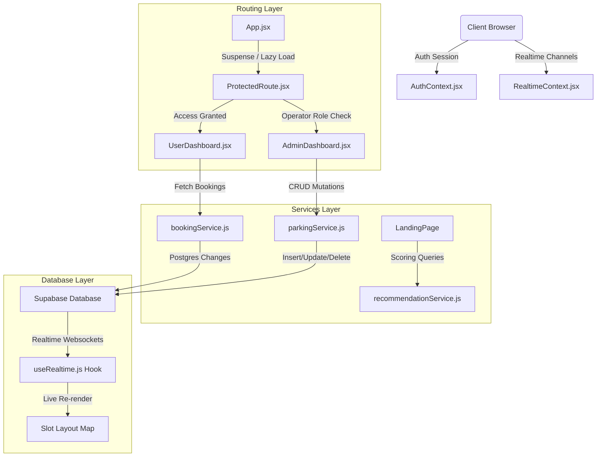

# EZPARK - Premium AI-Powered Organized Parking Facilities Platform

EZPARK is a production-ready, full-stack, AI-powered smart parking management platform designed for organized parking facilities (shopping malls, airports, hospitals, railway stations, universities, office complexes, event venues, and private parking operators).

---

## 1. Folder Structure

```text
ezpark/
├── database/
│   └── supabase/
│       └── 001_initial_schema.sql  # Database Schema & RLS Migrations
├── src/
│   ├── assets/                     # Media & Static Files
│   ├── components/
│   │   ├── admin/                  # Console Subcomponents
│   │   │   ├── ActivityLogs.jsx    # Operator audit reports
│   │   │   ├── Stats.jsx           # Metrics counters
│   │   │   ├── ParkingTable.jsx    # Table listings
│   │   │   └── ParkingModal.jsx    # Add/Edit facility forms
│   │   ├── ai/
│   │   │   ├── RecommendationCard.js # Scored suggestion card
│   │   │   └── RecommendationList.js # Range parameters sliders
│   │   ├── auth/
│   │   │   └── AuthLayout.jsx      # Spotlight backdrop layout
│   │   ├── dashboard/
│   │   │   ├── Sidebar.jsx         # Collapsible menu
│   │   │   ├── Topbar.jsx          # Header with status indicator
│   │   │   ├── StatsCards.jsx      # Animated count summaries
│   │   │   └── BookingCards.jsx    # Active passes & scanner dialog
│   │   ├── landing/
│   │   │   ├── Hero.jsx            # Dynamic cinematic Stage
│   │   │   ├── ParkingSearch.jsx   # Tabbed lookup search
│   │   │   └── BookingSection.jsx  # Real-time interactive slot selector
│   │   ├── layout/
│   │   │   └── Navbar.jsx          # Centered glassmorphic header
│   │   ├── map/
│   │   │   ├── ParkingMap.jsx      # Leaflet mapping integrations
│   │   │   ├── ParkingList.jsx     # Side filter panels
│   │   │   └── MapMarker.jsx       # Custom divIcon elements
│   │   └── monitoring/
│   │       └── HealthStatus.jsx    # Uptime monitors grid
│   ├── contexts/
│   │   ├── AuthContext.jsx         # Sessions & roles managers
│   │   ├── RealtimeContext.jsx     # Socket connection status indicators
│   │   ├── ProtectedRoute.jsx      # Guard blocks for routing
│   │   └── ToastContext.jsx        # Glass modal alert notifier
│   ├── data/
│   │   └── parkingData.js          # Core static configurations fallbacks
│   ├── hooks/
│   │   └── useRealtime.js          # Custom PostgreSQL slot subscription hooks
│   ├── pages/
│   │   ├── Landing.jsx             # Main visitor land page
│   │   ├── Login.jsx               # Email validations panel
│   │   ├── Signup.jsx              # Customer registrations
│   │   ├── ForgotPassword.jsx      # Email recovery pass dispatcher
│   │   ├── UserDashboard.jsx       # Secured operations stats
│   │   └── AdminDashboard.jsx      # Secured console management
│   ├── services/
│   │   ├── supabase.js             # Supabase Client instantiation
│   │   ├── authService.js          # Auth flows api
│   │   ├── parkingService.js       # Facility fetching and CRUD updates
│   │   ├── bookingService.js       # Reservation locks & checkout rules
│   │   ├── userService.js          # User audits fetches
│   │   ├── activityService.js      # Local audits tracker
│   │   └── recommendationService.js# AI scoring pipeline
│   ├── styles/                     # CSS files variables & components
│   ├── App.jsx                     # Suspense lazy router mappings
│   └── main.jsx                    # Root client mounting
├── .env.example                    # Env templates
└── README.md                       # Architectural report (this file)
```

---

## 2. Architecture & Data Flow



---

## 3. Database Schema

### Tables Specification

#### 1. `users`
Profiles linked to Supabase Auth metadata.
- `id` (uuid, primary key) $\rightarrow$ references `auth.users(id)`
- `first_name` (text), `last_name` (text)
- `phone_number` (text)
- `role` (text) $\rightarrow$ defaults to `'user'` (check constraint: `'user'|'operator'`)
- `created_at` (timestamp)

#### 2. `parking_facilities` (formerly parking_lots)
Listings of parking facilities directory.
- `id` (uuid, primary key)
- `name` (text, not null)
- `address` (text), `city` (text)
- `latitude` (double precision), `longitude` (double precision)
- `total_slots` (integer), `available_slots` (integer)
- `price_per_hour` (numeric(10,2))
- `has_ev_charging` (boolean), `has_cctv` (boolean), `is_covered` (boolean)
- `open_time` (time), `close_time` (time)
- `is_open` (boolean)

#### 3. `parking_slots`
Individual slots nested inside facilities with floor levels and accessibility indicators.
- `id` (uuid, primary key)
- `facility_id` (uuid) $\rightarrow$ references `parking_facilities(id)` on delete cascade not null
- `slot_number` (text)
- `floor` (text) $\rightarrow$ defaults to `'L1'`
- `is_accessible` (boolean) $\rightarrow$ defaults to `false`
- `type` (text) $\rightarrow$ `'car'|'bike'|'ev'`
- `status` (text) $\rightarrow$ `'available'|'occupied'|'reserved'|'maintenance'|'unavailable'`

#### 4. `bookings`
Historical reservation listings.
- `id` (uuid, primary key)
- `user_id` (uuid) $\rightarrow$ references `users(id)` on delete cascade not null
- `facility_id` (uuid) $\rightarrow$ references `parking_facilities(id)` on delete cascade not null
- `slot_id` (uuid) $\rightarrow$ references `parking_slots(id)` on delete cascade not null
- `vehicle_type` (text)
- `booking_date` (date), `entry_time` (time), `exit_time` (time)
- `total_amount` (numeric(10,2)), `status` (text) $\rightarrow$ `'Confirmed'|'Cancelled'`

---

## 4. API Reference Summary

Service calls interact with Supabase client libraries:

- **`authService`**:
  - `signUp(email, password, first, last, phone)`: Dispatches email register credentials.
  - `signIn(email, password)`: Validates JWT access token.
  - `signOut()`: Terminates active sessions.
- **`parkingService`**:
  - `fetchLots()`: Lists active facilities.
  - `fetchSlotsForLot(facilityId)`: Lists layout matrices.
  - `createLot(data)` / `updateLot(id, data)` / `deleteLot(id)`: Console CRUD.
- **`bookingService`**:
  - `createBooking(data)`: Validates slot status, locks the slot to `'reserved'`, writes the booking row, and saves payments.
  - `cancelBooking(id, slotId)`: Updates booking status to `'Cancelled'` and resets slot status back to `'available'`.
- **`recommendationService`**:
  - `getRecommendations(preferences)`: Scores parking spaces based on walking distance, budget limits, occupancy percentages, and rates.

---

## 5. Setup & Installation Guide

### Prerequisites
- Node.js (v18+)
- Supabase Project Database

### Local Deployment
1. Clone the project files.
2. In the root directory, create a `.env` file from the env example:
   ```bash
   cp .env.example .env
   ```
3. Update `VITE_SUPABASE_URL` and `VITE_SUPABASE_ANON_KEY` in `.env`.
4. Install all package dependencies:
   ```bash
   npm install --legacy-peer-deps
   ```
5. Run the local development server:
   ```bash
   npm run dev
   ```
6. Build project for production verification:
   ```bash
   npm run build
   ```

---

## 6. Deployment Strategy

### Frontend $\rightarrow$ Vercel
1. Link your GitHub repository to Vercel.
2. Define the Environment Variables:
   - `VITE_SUPABASE_URL`
   - `VITE_SUPABASE_ANON_KEY`
3. Set build configuration parameters:
   - Build Command: `npm run build`
   - Output Directory: `dist`

### Database $\rightarrow$ Supabase
1. Create a new project in the Supabase Dashboard.
2. Navigate to SQL Editor and execute the schema scripts from `database/supabase/001_initial_schema.sql`.
3. Enable Replication on tables `parking_slots` and `bookings` under Database $\rightarrow$ Replication to activate realtime features.
